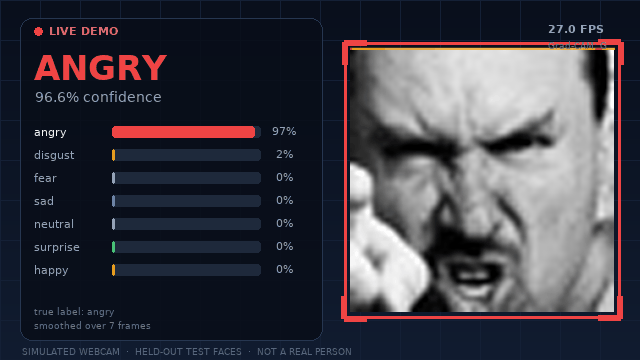
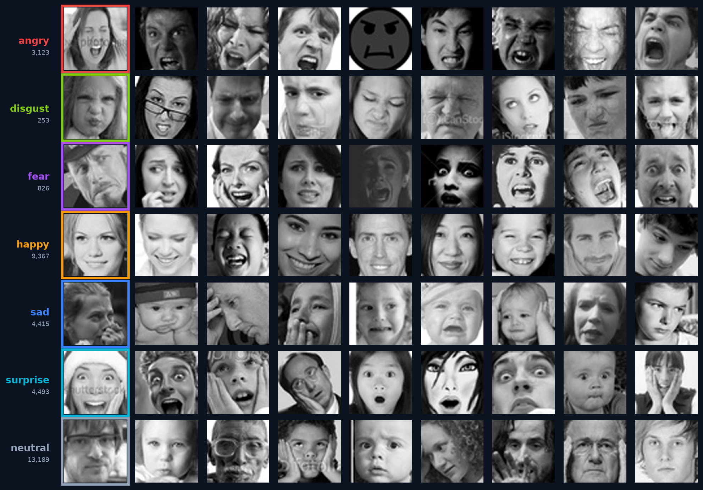
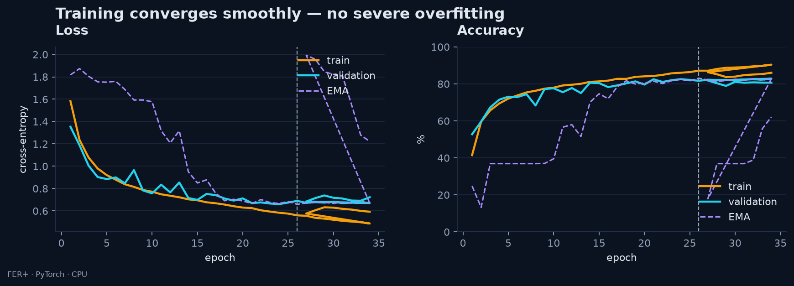
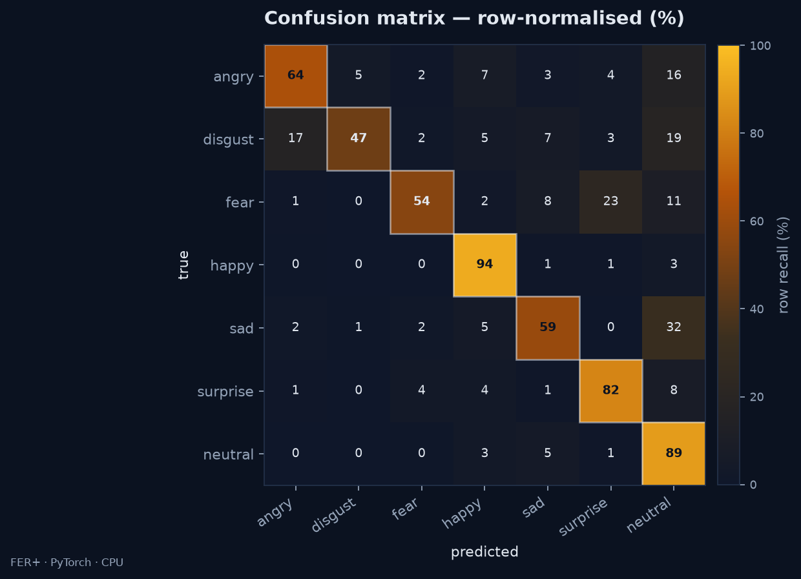
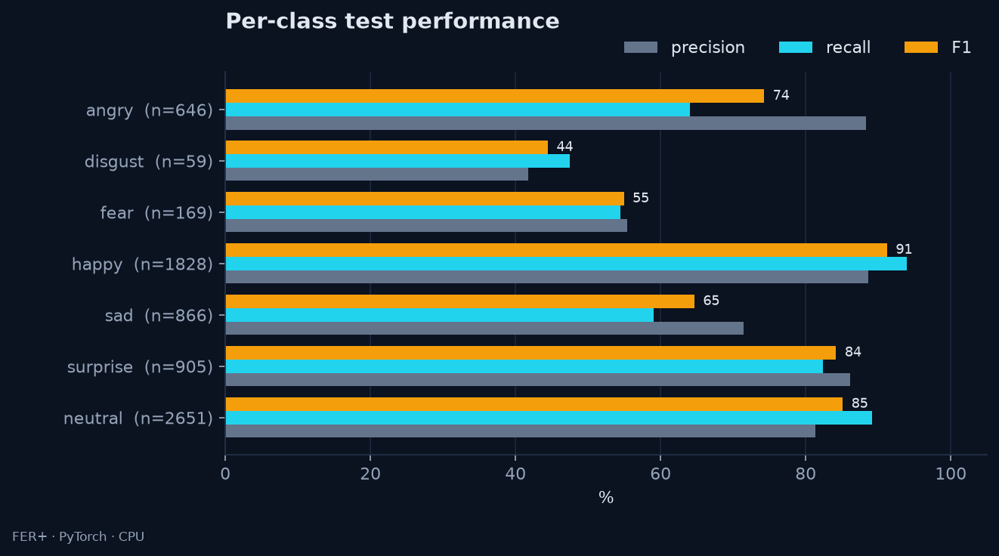
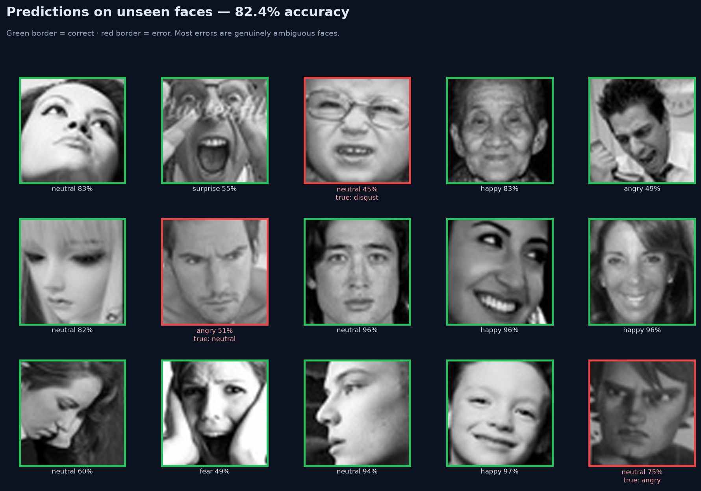
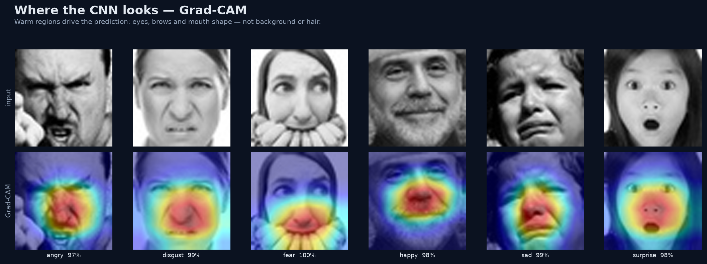

# Real-Time Facial Emotion Recognition

A compact convolutional neural network that reads a face and predicts one of seven
expressions — trained from scratch on FER2013, explained with Grad-CAM, and wrapped in a
real-time OpenCV demo that runs on a laptop CPU.



**65.0% test accuracy · 61.5% macro F1 · 11.1 ms CNN forward pass · 29.6 FPS full loop**

The demo above is simulated from held-out test faces, so no webcam or real person is
required. The same code path runs on a live camera with `--source 0`.

---

## Results at a glance

| Metric | Value |
| --- | --- |
| Test accuracy | **65.0%** (4,664 / 7,178) |
| Macro F1 | **61.5%** |
| Weighted F1 | 64.1% |
| Parameters | 1,767,079 (1.77M) |
| CNN forward latency | 11.1 ms per 48×48 face (CPU, no TTA) |
| Full real-time loop | 29.6 FPS (detect + classify + smooth + draw, 960×540) |
| Training | 36 epochs · 57 min · CPU only |
| Best validation epoch | 32 (65.7% accuracy) |

Evaluation uses the official 7,178-image FER2013 test split with horizontal-flip TTA.
The model lands 0.5 points **below** the 65.5% human benchmark reported with FER2013. It is a teaching baseline, not a state-of-the-art result.

## Try it

```bash
cd dl-project
python3 -m venv .venv
source .venv/bin/activate
pip install -r requirements.txt

make data      # download the FER2013 train/test pickles (~50 MB)
make demo      # simulated webcam from held-out faces (no camera needed)
make eval      # evaluate the checkpoint, rebuild figures/GIF, benchmark FPS

```

`make eval` ends with `python -m src.benchmark`, which runs the exact real-time loop
headlessly and writes `reports/fps.txt`; the deck reads that measured value instead of
hard-coding a throughput claim.

For a real webcam:

```bash
python -m src.realtime --source 0
```

| Key | Action |
| --- | --- |
| `Q` / `Esc` | quit |
| `G` | toggle Grad-CAM |
| `B` | toggle probability bars |
| `S` | save a screenshot |
| `Space` | pause |

`--source` also accepts a video path, an image path, or `demo`. Use `--record live.mp4`
to save an annotated clip and `--no-display` for headless runs. On a server without a
display, install `opencv-python-headless>=4.9,<5` instead of `opencv-python`; OpenCV 5
removed the Haar `CascadeClassifier` API used here.

## Project layout

```
dl-project/
├── src/
│   ├── config.py        paths, class names, colours, hyperparameters
│   ├── data.py          FER2013 loader, stratified split, augmentation
│   ├── model.py         EmotionCNN (1.77M parameters)
│   ├── train.py         CPU training loop, cosine schedule, early stopping
│   ├── evaluate.py      test metrics, latency, all report figures
│   ├── inference.py     checkpoint loading, face detection, preprocessing
│   ├── gradcam.py       Grad-CAM implementation
│   ├── realtime.py      webcam / video / image / simulated demo
│   ├── predict.py       annotate a single image or a folder
│   ├── plots.py         matplotlib figures and face crops
│   ├── make_assets.py   animated demo GIF and still frame
│   ├── benchmark.py     headless FPS benchmark -> reports/fps.txt
│   ├── build_deck.py    fill the HTML template with measured numbers
│   └── export_deck.py   render slides, PDF and contact sheet with Chromium
├── models/emotion_cnn.pt
├── reports/             metrics.json, history.json, figures, logs
├── presentation/        index.html, deck.pdf, slides, template, assets
├── scripts/download_data.sh
├── requirements.txt
└── Makefile
```

## How it works

```
webcam frame
   → Haar cascade (largest frontal face)
   → 10% margin crop, grayscale, resize to 48×48
   → EmotionCNN → 7 logits → softmax
   → horizontal-flip TTA (evaluation and demo)
   → rolling mean over 7 frames (demo only)
   → label, confidence, probability bars, optional Grad-CAM
```

### Architecture

| Stage | Output | Channels | Operation |
| --- | --- | --- | --- |
| Input | 48×48 | 1 | grayscale, normalised to [−1, 1] |
| Stage 1 | 24×24 | 32 | 2× conv 3×3 + BN + ReLU, max-pool, dropout 0.25 |
| Stage 2 | 12×12 | 64 | 2× conv 3×3 + BN + ReLU, max-pool, dropout 0.25 |
| Stage 3 | 6×6 | 128 | 2× conv 3×3 + BN + ReLU, max-pool, dropout 0.30 |
| Stage 4 | 3×3 | 256 | 1× conv 3×3 + BN + ReLU, max-pool, dropout 0.30 |
| Head | 7 | — | flatten 2,304 → FC 512 + BN + ReLU + dropout 0.40 → FC 7 |

The last convolution (`6×6×256`) is the Grad-CAM target. There is no pretraining, no
face-landmark model and no external training data: the weights start from random
initialisation and see FER2013 only.

## Training recipe

| Setting | Value |
| --- | --- |
| Data | 28,709 train images; 10% stratified validation (25,837 / 2,872) |
| Optimiser | AdamW, lr 1e-3, weight decay 1e-4 |
| Schedule | 3-epoch warm-up + cosine decay, early stopping patience 10 |
| Loss | cross-entropy + label smoothing 0.05 + √-inverse class weights |
| Batch / dropout | 128 / 0.25–0.40 |
| Augmentation | flip, ±12° rotation, 0.9–1.1× scale, ±7% translation, ±20% brightness/contrast, random erasing |
| Compute | CPU only, 4 PyTorch threads, 40-epoch budget |



```bash
python -m src.train --epochs 40 --workers 4 --threads 4 --patience 10
```

The included checkpoint is the best validation epoch (32) from that run. The
final train–validation accuracy gap was 1.3 points, which is why the report leans on
the held-out test split and per-class metrics rather than training accuracy.

## FERPlus training (additional)

An additional ResNet (width 32) was trained on FERPlus labels:

| Setting | Value |
| --- | --- |
| Architecture | ResNet (width 32), ~2.81M parameters |
| Data | FERPlus (25,687 train / 2,855 val) |
| Checkpoint | `models/emotion_cnn_ferplus.pt` |
| Best validation accuracy | **83.08% @ epoch 26** |
| Training | Resumed from epoch 26; stopped early at **epoch 32/40** (no improvement over best) |
| Compute | CPU only, 4 PyTorch threads |

## Evaluation





Rows are true labels. The diagonal is strong for happy and surprise; the largest
off-diagonal flows are:

| Confusion | Test images | Share of true class |
| --- | ---: | ---: |
| sad → neutral | 367 | 29% |
| fear → sad | 212 | 21% |
| fear → neutral | 182 | 18% |
| angry → neutral | 164 | 17% |
| fear → angry | 130 | 13% |

### Per-class test metrics

| Expression | Precision | Recall | F1 | Test images |
| --- | ---: | ---: | ---: | ---: |
| angry | 58.3% | 56.9% | 57.6% | 958 |
| disgust | 46.8% | 66.7% | 55.0% | 111 |
| fear | 60.2% | 31.6% | 41.5% | 1,024 |
| happy | 85.2% | 86.6% | 85.9% | 1,774 |
| sad | 55.9% | 47.2% | 51.2% | 1,247 |
| surprise | 75.8% | 80.4% | 78.0% | 831 |
| neutral | 51.3% | 75.2% | 61.0% | 1,233 |





Green borders are correct, red borders are errors. These are randomly sampled held-out
faces, not cherry-picked successes. Most mistakes are low-contrast, occluded or genuinely
ambiguous expressions.

### What the model looks at



Grad-CAM heat concentrates on brows, eyes and mouth shape rather than hair or background.
That is a useful sanity check: a heat map that drifts to the frame border usually signals a
dataset artefact.

## Presentation

`presentation/index.html` is a 15-slide deck with its fonts embedded and figures linked
from `presentation/assets/`. Keep the `presentation/` folder together and it works
directly from disk — no server or network required.

```bash
open presentation/index.html          # macOS
xdg-open presentation/index.html     # Linux
```

Use `←` / `→` to navigate, `N` for speaker notes, `F` for fullscreen and `?` for all
shortcuts. `presentation/deck.pdf` is the exported 16:9 PDF, and
`presentation/contact_sheet.png` shows every slide at once.

Rebuild the deck after a new evaluation:

```bash
python -m src.evaluate     # writes reports/metrics.json and figures
python -m src.make_assets  # writes the demo GIF and still
python -m src.benchmark    # measures FPS -> reports/fps.txt
python -m src.build_deck   # fills presentation/index.html
pip install -r requirements-dev.txt
playwright install chromium
python -m src.export_deck  # writes deck.pdf + contact_sheet.png
```

## Limitations and ethics

- **An expression is not an emotion.** A smile can be polite, nervous or ironic. FER2013
  labels are crowd judgments of outward appearance, not verified inner states.
- **The data is old, noisy and unbalanced.** Web images from 2013, crowd labels and no
  demographic balance. Accuracy will not transfer equally across skin tones, ages,
  cultures, lighting or camera angles. No fairness audit is included here.
- **The input is tiny.** 48×48 grayscale removes colour, pose, body language and context;
  side profiles, masks, glasses and occlusion are outside the training distribution.
- **The demo tracks one face.** Haar detection returns the largest frontal face and the
  overlay does not attempt multi-face identity tracking.
- **Not for high-stakes decisions.** Do not use this model for hiring, policing, credit,
  medical triage, surveillance or any decision that affects a person's access, safety or
  dignity. Capture requires informed consent and a clear opt-out.

## References

- Goodfellow, I. J. et al. (2013). *Challenges in Representation Learning: A Report on
  Three Machine Learning Contests.* ICONIP. (FER2013; human accuracy ≈ 65.5%.)
- Selvaraju, R. R. et al. (2017). *Grad-CAM: Visual Explanations from Deep Networks via
  Gradient-based Localization.* ICCV.
- FER2013 pickle splits used here: <https://huggingface.co/datasets/Jeneral/fer-2013>.

## License

MIT — see [LICENSE](LICENSE). The FER2013 images retain their original terms; this
repository is for research and teaching use. The deck embeds Inter (SIL Open Font
License 1.1) and a small DejaVu Sans subset (Bitstream Vera license) so it renders
offline.
